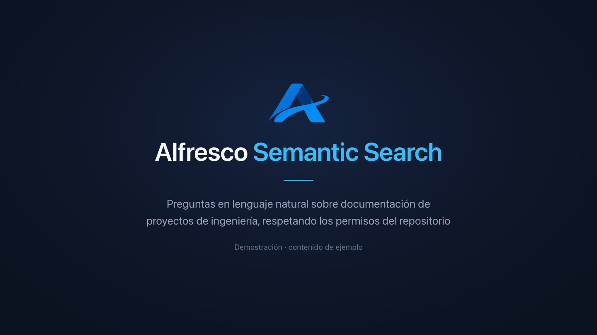

# Alfresco Semantic Search

**Permission-aware semantic search over an [Alfresco](https://www.alfresco.com/)
repository.** Ask in natural language, get back only the documents the asking
user is actually allowed to read.

> **Permissions are never copied into the vector database.**
> Alfresco validates access at query time, as the end user.

That sentence is the difference between this and a generic RAG pipeline.
Copying Alfresco's resolved permission list into your own index is the obvious
shortcut, and it **fails open**: revoke someone's access in the repository and
your copy keeps serving them the content until the next sync. This project
measured that leak, then designed it away — see
[why copying ACLs fails open](#why-not-copy-the-acls).

Built on AI embeddings, PostgreSQL and
[pgvector](https://github.com/pgvector/pgvector). Nothing is installed inside
Alfresco: the repository is consumed through its public API and its event
stream, so upgrading it does not break this.

## Demo

[](https://www.youtube.com/watch?v=eej4AtKW8w4)

The same question, asked by two different users, returns a different set of
documents — because Alfresco decides what each of them may read, not the
assistant. One minute, Spanish captions.

The assistant in the video is a client deployment; what is published here is
the retrieval component underneath it.

```
Event2 ──► classify ──► extract ──► chunk ──► embed ──► pgvector
                                                            │
query ──► embed ──► kNN (over-fetch) ──────────────────────► │
                              │                              │
                              ▼                              │
                    Alfresco: "which of these node ids        │
                     may THIS user read?" ◄──────────────────┘
                              │
                              ▼
                     context ──► your LLM
```

Verified against **Alfresco Content Services Community 26.2.0** (schema 21100).
The event consumer also works on 7.x — Event2 has existed since ACS 7.0.

---

## Why not copy the ACLs

Alfresco resolves every node's effective readers into a flat list and stores it
in its own search index, in a field called `READER`. Copying that field into
your vector store is tempting: one query, kNN and permission filter together,
no extra round trip. It works — and it **fails open**.

Measured on a live 26.2 instance:

```
A document's permissions are changed in Alfresco (inheritance cut, restricted
to two authorities).

22 seconds later:
  READER in Alfresco's index  →  ['GROUP_site_swsdp_SiteManager', 'admin']   updated
  READER in the copy          →  ['GROUP_EVERYONE', ...]                     stale

A user with no access queries the copy  →  receives all 3 chunks of the
                                            restricted document.
```

The failure mode is silent: no error, no warning, just content reaching someone
who should not see it. And the window stays open until the next sync.

Alfresco can afford a stale index because it re-validates permissions against
the database when it resolves each node — a second layer this project proved by
tampering with the index directly:

```
READER forged in Alfresco's index to include a user who cannot read the node.

Elasticsearch, queried alone  →  returns the document
Alfresco Search API           →  hits: 1,  entries: []     ← the repository said no
```

A vector store of your own has no such second layer. So this project stores no
permissions at all: **what you do not store cannot drift out of sync.**

The cost is one extra round trip per query. The benefit is that revoking access
in Alfresco takes effect on the next query, with no sync to wait for.

---

## Quick start

Needs Docker with ~6 GB available, and Python 3.11+.

```bash
git clone https://github.com/acubenslabs/alfresco-semantic-search
cd alfresco-semantic-search

# The alfresco-activemq image ships with only the openwire connector enabled;
# this extracts its own activemq.xml and uncomments STOMP.
scripts/enable-stomp.sh

docker compose up -d
docker compose logs -f alfresco        # wait for "Server startup"

pip install -e ".[postgres,dev]"
python scripts/demo.py
```

`scripts/demo.py` indexes two documents with different permissions, then runs
the *same* semantic query as two users:

```
indexed maintenance-plan.txt (1 chunks)
indexed settlement-terms.txt (1 chunks)

alice  sees 2 chunk(s) from ['maintenance-plan.txt', 'settlement-terms.txt']   (0 of 2 denied)
bob    sees 1 chunk(s) from ['maintenance-plan.txt']                           (1 of 2 denied)
```

It uses a deterministic fake embedder, so no API key is needed. Similarity is
meaningless there; the permission boundary is real.

---

## Usage

### Indexing

```python
import psycopg
from alfresco_semantic_search import (
    AlfrescoClient, ChunkStore, Event2Listener, Indexer,
    OpenAIEmbedder, TransformClient,
)

alfresco = AlfrescoClient("http://localhost:8080", "svc_indexer", "...")
transform = TransformClient("http://localhost:8090")
embedder = OpenAIEmbedder("text-embedding-3-small")

with psycopg.connect(DSN) as conn:
    store = ChunkStore(conn, dims=embedder.dims)
    store.init_schema()
    indexer = Indexer(alfresco, transform, store, embedder)

    with Event2Listener() as listener:
        for event in listener.events():
            indexer.handle(event)
```

### Querying

```python
from alfresco_semantic_search import Caller, search

result = search(
    embedder.embed(["what is the penalty clause?"])[0],
    Caller(username="bob", password="..."),   # the END USER, never admin
    store,
    alfresco,
    limit=10,
)

prompt = f"Answer using only this context:\n\n{result.as_context()}"
```

`search()` takes the end user's credentials rather than a pre-filtered list, so
the only available order is: retrieve, filter, *then* build the prompt. Running
those out of order leaks content, and trimming the citation list afterwards
does not undo it — the text is already in the prompt.

> **Never pass an administrative account as the `Caller`.** An admin can read
> everything, which silently turns the filter off.

---

## What Event2 tells you, and what it does not

Event2 publishes a CloudEvents 1.0 message to the ActiveMQ topic
`alfresco.repo.event2` on every node change. It ships enabled
(`repo.event2.enabled=true`); there is nothing to install.

The payload field holding the previous state is **`data.resourceBefore`** — not
`resourceBeforeUpdate` — and it contains **only the attributes that changed**.
That is what makes it possible to tell a content change from a rename without
fetching the node. Measured behaviour:

| Operation | Events | `resourceBefore` contains | `Change` | Re-embeds |
|---|---|---|---|---|
| Create a document | 3 | `[]` | `CREATED` | **yes** |
| Replace the content | 1 | `content`, `modifiedAt`, `properties` | `CONTENT` | **yes** |
| Move to another folder or site | 1 | `primaryHierarchy`, `properties` | `MOVED` | no |
| Rename in place | 2 | `name`, `primaryHierarchy`, `properties` | `RENAMED` | no |
| Edit a property | 1 | `localizedProperties`, `properties` | `METADATA` | no |
| Delete | 2 | `[]` | `DELETED` | no |
| **Change permissions** | **0** | — | — | — |
| **Start a workflow / complete a task** | **0** | — | — | — |

A move and a rename both change `primaryHierarchy`, because the primary
association's qualified name embeds the node name. The presence of `name` is
what separates them. Moves carry both the old and the new parent, so relocating
a document costs a metadata update, not a re-embed.

Two sources of noise worth filtering, both handled by `classify()`:

* Containers get an `Updated` carrying only `modifiedAt` whenever a child moves.
* A spurious `Updated` with `aspectNames` arrives right after every create —
  Alfresco applying `cm:versionable`. Indexing it embeds the document twice.

### Permission changes emit nothing

Measured three times on 26.2: changing a node's permissions produces **zero
events**. The `PERMISSION_UPDATED` constant exists in `acs-event-model`'s
`EventType` enum, but the repository does not emit it, and no property turns it
on. Alfresco's own documentation puts it as *"does not reliably emit permission
update events"*.

This is the single strongest argument for the design above: **the half of the
change stream you cannot observe is exactly the half you do not need to store.**

For reference, Alfresco's own RAG proof of concept chose to copy the ACLs, and
needed a Java addon deployed *inside* the repository, a persistent ActiveMQ
queue, a transacted listener and recursive descendant traversal to keep them
reconciled — and still documents cases that go stale.

### Workflows are visible only through documents

Event2 emits nothing for tasks or processes. A document entering a workflow
shows up as a child association instead:

```json
{"type": "org.alfresco.event.assoc.child.Created",
 "data": {"resource": {"assocType": "bpm:packageContains",
                       "parent": {"id": "..."},
                       "child":  {"id": "..."}}}}
```

`classify()` surfaces that as `Change.WORKFLOW`. The indexer ignores it by
default, but it is a useful gate: index only documents that have left the
approval circuit, rather than every draft.

---

## Text extraction

Rather than extracting text locally with a library per format, this hands the
bytes to `alfresco-transform-core-aio` — the same service the repository uses
to extract text for its own search index.

```python
raw = alfresco.content(node_id)
text = transform.to_text(raw, "application/pdf", filename="contract.pdf")
```

Two reasons it is worth the round trip:

* **Consistency.** The text you embed is the text Alfresco indexed. Semantic
  and keyword search see the same document.
* **Coverage.** Every format the repository handles works, including OCR when
  configured, with nothing per-format to maintain on your side.

Measured: a 6-page, 381 KB PDF yields 12,494 characters of text in one POST.

> Health-check `/ready`, not `/actuator/health`. The aggregate actuator endpoint
> reports `DOWN` with HTTP 503 on a healthy transform service while its own
> `liveness` and `readiness` groups both report `UP`.

---

## Events are not enough

A plain topic subscription has no memory: events published while the consumer
is down are lost, not queued. Use a durable subscription, or ActiveMQ's Virtual
Topic pattern, which Alfresco's own configuration leaves commented out:

```properties
#repo.event2.topic.endpoint=amqp:topic:VirtualTopic.alfresco.repo.event2
```

And pair it with a periodic sweep. Alfresco does: `batch-indexing` runs
`reindexByDate` jobs with a watermark over the database *in addition to*
consuming events. Events give you latency; the sweep gives you completeness.

```python
from alfresco_semantic_search import reconcile

report = reconcile(alfresco, store, indexer, query='TYPE:"cm:content"')
print(report.summary())   # scanned=1204 missing=0 stale=2 orphaned=11 reindexed=2
```

`drifted` consistently above zero means the event path is losing messages.

Orphaned chunks — documents deleted in Alfresco — are **invisible, not
dangerous**: the permission check simply never returns them. They waste space,
so `delete_orphans=True` on a monthly run is enough.

---

## Operational notes

Things measured on a stock 26.2 install that are worth knowing before you scale
this:

**The repository's connection pool leaves almost no room.** `db.pool.max` is
275, `batch-indexing` holds ~20, and PostgreSQL ships with
`max_connections=300`. That is why this project's vector store runs on a
**separate** PostgreSQL: pointing it at Alfresco's database would compete for
the last five connections, and exhausting the pool stops the repository from
responding.

**Tomcat defaults to 200 threads** and the shipped `server.xml` declares no
`maxThreads`. A content download holds a thread for the whole transfer, so
concurrent downloads of large documents are the first ceiling you hit.

**Search is cheap; returning results is not.** Alfresco asks Elasticsearch for
IDs only (`"_source": false`), then loads each node from PostgreSQL and
re-validates permissions. Finding a match among millions of documents is fast;
returning a thousand of them is a thousand node loads. Paginate.

**Audit is off by default.** `audit.enabled=true` but
`audit.alfresco-access.enabled=false`, so a stock install does not record who
read what — despite the discovery API reporting auditing as enabled. Relevant
if you need an access trail for what your assistant surfaced.

---

## Layout

| Module | What it does |
|---|---|
| `events.py` | Event2 STOMP consumer and the change classifier |
| `alfresco.py` | REST client — content, metadata, and `readable_ids()` |
| `extract.py` | Text extraction via the transform service |
| `chunking.py` | Paragraph-aware splitting with overlap |
| `embeddings.py` | `Embedder` protocol, OpenAI backend, deterministic fake |
| `store.py` | pgvector schema and queries — **no ACL columns** |
| `indexer.py` | Applies classified events to the store |
| `retrieval.py` | Permission-aware search |
| `reconcile.py` | The periodic sweep |

The classifier and the permission filter are the parts worth copying. Chunking
and embedding are commodity — swap in whatever you already trust.

```bash
pytest          # 15 tests, all on the classification rules
ruff check .
```

---

## Limitations

* **Community Edition only, tested.** The code uses nothing Enterprise-specific,
  but it has not been run against an Enterprise repository.
* **Latency, not immediacy.** The permission check goes through Alfresco's search
  API, which needs the node in its own index first — `batch-indexing` polls
  every 15 seconds by default. A document created a second ago is not yet
  retrievable.
* **Hybrid retrieval is not included.** Combining BM25 and vector scores with
  reciprocal rank fusion is ~10 lines and worth adding; Elasticsearch's own RRF
  is license-gated on the free tier (`current license is non-compliant for
  [Reciprocal Rank Fusion (RRF)]`), so doing it in your own code is both cheaper
  and more portable.
* **No reranker, no query expansion.** Out of scope on purpose.

---

## Licence

Apache 2.0.

Built by **[Acubens](https://www.acubens.com.ar)** — a Buenos Aires software
studio implementing Alfresco in Argentina since 2010, for organisations in
health, energy and regulated industries. Seven Alfresco deployments in
production.

Corrections and measurements from other versions are welcome: open an issue
with the version you tested on.
